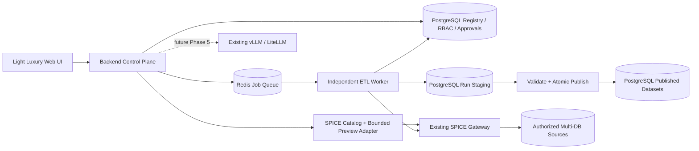

# U-ETL v2 — Implementation Prompt (Phase 0–4 Only)

**Date:** 2026-10-26  
**For:** Claude Code / AI Coding Agent (Lead Engineer / Orchestrator)  
**Scope:** Implement **Phase 0, 1, 2, 3 and 4 only**. **Do not implement Phase 5–7.**  
**Project:** Existing U-ETL Factory Data Bridge repository. Locate the actual repository root; do not assume paths outside it.

## 1. Your mission

Act as Lead Software Architect, Data Platform Engineer, Backend Engineer, Frontend UX Engineer, Security Reviewer and QA Orchestrator. Evolve the existing U-ETL prototype into a **SPICE-centric multi-database data integration platform** with a durable, independent ETL execution service and **SQL + Visual pipeline authoring**. Preserve working behavior where reasonable, but replace mock and in-memory-only paths with real, tested contracts. Build iteratively and report verifiable evidence after every phase.

**Hard stop:** Phase 0 is research/design only. Present the verified capability matrix, architecture, UI design, risks, rollout and tests to the owner. **Do not change application code, install infrastructure, connect to production services, migrate a DB or deploy until Gate 0 is explicitly approved.** For Phases 1–4, do not progress past a failed gate or unresolved blocker without owner approval. Work on feature branches, keep rollback possible, and never destroy existing data.

## 2. User-confirmed target decisions

| Domain | Requirement |
|---|---|
| Connectivity | Existing **SPICE** is the central gateway to multiple databases. Support **REST** and **Arrow Flight SQL/ODBC** where the deployed service actually supports them. Capability-driven, not assumed. |
| Source access | SPICE-only for newly configured connections by default; legacy Oracle direct adapter isolated and disabled by default. No silent fallback. |
| Deployment | **Linux + Docker Compose**, separate UI, API, Redis, ETL worker and PostgreSQL services. **Reuse** the user's existing SPICE and vLLM installations. |
| Dataset target | **PostgreSQL**; separate metadata/registry, run staging and published datasets by schema/database and privilege. |
| Queue | **Redis + independent worker**, with PostgreSQL authoritative run/attempt/approval records. |
| AI | Existing **vLLM/LiteLLM-compatible endpoint** is a future integration, **NOT implemented in Phase 0–4**. Provide a clean future adapter seam and configuration UI placeholder only. No mock AI pretending to be real. |
| Authoring | **SQL and Visual Mapping** coexist, can compose typed steps, share a versioned Pipeline Definition and a single approval/execution lifecycle. |
| Identity | Multi-user authentication, server-enforced **RBAC**, object-level authorization, revision-bound human approval and audit. |
| UX | **Light Luxury Tech**: pearl white, soft lavender, ice blue, premium micro-interactions, refined glass surfaces and restrained animation. **Never dark-first.** |
| Data movement | No bulk ETL in browser or Web/API process. API handles bounded preview and control metadata; **worker reads SPICE directly** and writes PostgreSQL. |

Existing SPICE and vLLM services are reported by the owner, but endpoints, auth, protocols and capabilities are **unverified** until authorized testing. Do not create replacement instances.

## 3. Mandatory audit baseline

Read all ten reports before planning implementation (if paths differ, locate the actual files and document paths):

1. `docs/architecture-audit/00-executive-summary.md`
2. `docs/architecture-audit/01-system-inventory.md`
3. `docs/architecture-audit/02-frontend-api-inventory.md`
4. `docs/architecture-audit/03-database-storage-audit.md`
5. `docs/architecture-audit/04-spice-integration-readiness.md`
6. `docs/architecture-audit/05-etl-execution-audit.md`
7. `docs/architecture-audit/06-sql-etl-ai-mapping-audit.md`
8. `docs/architecture-audit/07-security-performance-risks.md`
9. `docs/architecture-audit/08-v2-gap-analysis.md`
10. `docs/architecture-audit/09-architecture-recommendations.md`

The audit (2026-10-26) is **static inspection, not runtime certification**. It found a Vanilla JS frontend, Python standard-library API, working narrow Oracle read path, SQLite cache/target, ETL thread within API, in-memory jobs, mock approvals, no SPICE adapter, no SQL ETL, and no Local LLM integration. Critical issues include whole-result accumulation in RAM, numeric precision risk, non-atomic status/publication, missing server-side RBAC, and unsafe inline JS contexts. Re-check these facts in the current checkout. Do not confuse prototype/demo artifacts with live functionality.

Create a migration matrix: old module → retain/refactor/retire → new component → tests → rollout/rollback. Preserve the old pilot behind an isolated rollback path until acceptance tests pass.

## 4. Non-negotiable architecture

- API owns auth, connections *references*, catalog, limited preview, definitions, review/approval, queue submission, schedules (if approved), status, audit and settings. **Never bulk extract/load inside API**.
- Worker owns extraction, streaming/batching, typed transformations, staging, validation, publication, checkpoints and recovery. Independently deployable, with CPU/memory/concurrency limits.
- SPICE owns source connectivity. U-ETL must use source identifiers and scopes provided by the deployed SPICE; do not invent SPICE endpoints or assume it supports CDC, streaming, snapshots, cancellation or SQL dialect features.
- PostgreSQL is authoritative for job and approval state; Redis carries work, not proof of success. Design for **at-least-once delivery + idempotent effects**, not magical exactly-once delivery.
- Credentials stay server-side via secret references/secret manager/environment injection. No plaintext in browser localStorage, screenshots, audit records, committed `.env`, prompts or logs.
- All source queries run read-only with source-side grants, authorized objects, typed binds, timeout/row/byte budgets. SQL parser alone is insufficient.
- Publish only after validation, with transactional or generation-swap semantics and tested recovery at commit boundaries. Do not mark success before commit.

## 5. Required UI direction for Phase 0–4

**A polished UI is part of Phase 0–4, not deferred wholesale to Phase 6.** Implement the actual screens needed for Phases 1–4 using the approved Light Luxury system; full cross-product refinement is out of scope.

Design language: `#F8FAFF` / pearl white backgrounds, pale lavender and ice-blue accents, deep ink text (not dark backgrounds), subtle borders, airy spacing, restrained translucency, high legibility. Choose and document exact tokens and accessible contrast; values above are starting suggestions, not final approved tokens. Prefer React + Vite + TypeScript **only after Phase 0 migration/architecture approval**; otherwise document and justify a different path. Componentized forms/tables; avoid global inline handlers and untrusted HTML insertion.

Reference research (do not clone copyrighted designs):
- `https://kexsio.com/animations` — animated cards, refined transitions, glass navigation and subtle background motion.
- `https://threeui.com/browse?sort=recent` — selective interactive/WebGL embellishments, never heavy rendering in data tables/SQL editor.
- `https://kitbitz.art/` — inspect and verify availability and exact relevant examples; if inaccessible, mark **NOT VERIFIED**, do not fabricate named components.

Motion requirements: page entry 180–320 ms, tasteful hover/focus feedback, animated pipeline edge/data flow while running, meaningful job status changes; **no infinite decorative animation over SQL/editor/table content**. Support `prefers-reduced-motion`, keyboard navigation, screen readers, responsive layout, graceful fallback without WebGL and measurable performance. Motion values are proposals for approval, not mandates until Gate 0.

**Screens needed by Phase 4:** Login/Workspace, Dashboard shell, Infrastructure Settings, SPICE Connections, Catalog/Preview, Dataset Wizard, SQL + Visual Pipeline Studio, Review/Approval, Jobs/Monitoring, Dataset Registry. AI Assistant may show a clearly labeled **Coming in Phase 5** placeholder; do not claim functioning AI.

### Infrastructure Settings forms (editable, testable, safe)

- **SPICE REST:** display name, base URL, API route/version (verified), auth mode, secret reference/token input, TLS verification, timeout, scope/tenant, `Test Connection`, `Browse Catalog`.
- **SPICE Arrow Flight SQL/ODBC:** host, port, transport/TLS, driver/DSN, auth mode, secret reference, catalog/schema, timeout, `Test Connection` and capability status.
- **Redis:** hostname, port, TLS, ACL username, password secret reference, queue namespace, DB index (if applicable), `Test Connection`, health/latency, broker persistence status.
- **PostgreSQL:** host, port, database, TLS, registry/target schema, user/secret reference, `Test Connection`, migration status.
- **vLLM/LiteLLM (future Phase 5):** base URL, model ID, auth secret reference, optional health check **only if authorized**; no inference integration in this scope.

Never echo credentials back to browser after save. Connection tests must run from server-side, enforce RBAC, avoid SSRF via arbitrary internal endpoints, have strict timeouts, sanitized error messages and audit records. Support secret rotation and status indicators without revealing secrets. External services should be **referenced**, not automatically provisioned over existing installations.

## 6. Common pipeline definition (Phase 4 contract)

Define a versioned, immutable pipeline specification, with at least:

`pipeline_id, revision_id, workspace_id, authoring_mode (visual/sql/hybrid), source_connection_ref, source_catalog_revision, source_object_allowlist, dialect, extract_sql_or_typed_nodes, typed_parameters, transforms, output_schema, grain_and_business_keys, target_schema/table, write_mode, quality_rules, query_budgets, schedule_policy, approval_state, approver_evidence, lineage, checksum`.

Represent visual nodes as typed operations, not executable arbitrary JS. SQL and Visual modes compile to a shared, validated intermediate execution plan. Define what is round-trippable and what is not; do not silently alter SQL or lose semantics when switching editors. Every submitted job references an **approved immutable revision**, never a mutable browser draft.

## 7. Execution phases and hard verification gates

### Phase 0 — Evidence, architecture, design and approval (NO CODE)

**Tasks**
1. Read all 10 audits, inspect actual repository and existing UI/API. Inventory dependencies, tests, deployed services and known defects. Identify inconsistencies with the audit.
2. With explicit permission, conduct read-only, non-destructive SPICE capability checks: deployed product/version, REST/OpenAPI availability, Flight SQL/ODBC, auth/tenant scopes, catalog, parameter binds, query streaming/pagination, cancellation, limits, source snapshot semantics and worker extraction suitability. A protocol being advertised does **not** prove bulk extraction.
3. Check Linux/Docker topology, PostgreSQL roles/schema/backup, Redis TLS/ACL/persistence/queue semantics, vLLM endpoint availability (no model integration yet). If access unavailable, mark **UNKNOWN/BLOCKED**, do not guess.
4. Decide framework migration strategy, worker library and recovery protocol, secret management, target publish semantics, SQL dialect/AST validation strategy and staged rollout.
5. Research the 3 design references with screenshots/links where permitted; document verified inspirations vs unverified references. Produce Light Luxury tokens, responsive wireframes, animation spec and screen-by-screen navigation.
6. Create a dependency/risk matrix, API/DB contracts, source-to-target migration map, explicit tests and rollback plan.

**Required deliverables**
- `docs/v2/00-open-decisions.md` — owner, question, risk, status.
- `docs/v2/01-capability-matrix.md` — SPICE REST/Flight, Redis, PostgreSQL, vLLM: VERIFIED / UNKNOWN / UNSUPPORTED with evidence.
- `docs/v2/02-target-architecture.md` — topology, trust boundaries, failure modes.
- `docs/v2/03-contracts.md` — API, registry, queue payload, pipeline schema, source capability contract.
- `docs/v2/04-light-luxury-design.md` — design tokens, UI screens, motion, reference attribution, accessibility.
- `docs/v2/05-phase-test-plan.md` — acceptance fixtures, negative tests, load budgets, recovery cases.
- `docs/v2/06-migration-and-rollback.md` — existing modules, parity, flags, backup and restore.
- `docs/v2/07-phase-0-review.md` — executive recommendation and decisions requiring approval.

**GATE 0: STOP.** Show evidence and ask for explicit approval. No application code changes, installs, live migrations, or deployments prior to approval.

### Phase 1 — Docker foundation, registry, authentication and RBAC

**Tasks**
1. Create approved Docker Compose services for UI/API/worker/Redis/PostgreSQL as appropriate to the deployment plan. Use existing SPICE and vLLM as external endpoints; avoid duplicates. Separate dev/test/prod configuration.
2. Create PostgreSQL migrations for users, workspaces, memberships, roles, permission grants, connection refs, catalog snapshots, dataset/pipeline definitions and revisions, approval decisions, job runs/attempts, audit events, and secret refs. Distinct database roles and schemas for metadata, staging and published data.
3. Implement login/session management, password hashing or approved SSO, CSRF protection as appropriate, RBAC enforcement at **every** API and object boundary, workspace isolation, reviewer/approver separation of duties and immutable approval evidence bound to revision hashes.
4. Implement health/readiness endpoints, structured logs with correlation IDs, sanitized error responses and audit trail. Build Light Luxury login, shell/sidebar, workspace and user-management UI.
5. Add migrations/seed fixtures for tests only; no production credentials or automatic destructive migration.

**GATE 1 acceptance**
- Unauthorized/cross-workspace requests fail server-side; forged browser approval is rejected.
- Migrations, backup/restore and rollback tested in isolated environment.
- Sessions, CSRF, secure cookies, audit trail, secret handling and dependency health tested.
- Old pilot can still be rolled back to; no claims of production readiness without tests.

### Phase 2 — SPICE gateway, catalog and bounded preview

**Tasks**
1. Implement a `SpiceAdapter` abstraction with capability negotiation and explicit transport implementations: REST and Arrow Flight SQL/ODBC **only if verified**. Support independent capability flags; if one transport is unavailable, display it as unsupported rather than fabricating it.
2. Store only approved SPICE connection refs and scoped credentials; list authorized databases/catalogs/schemas/tables/columns and data types, permission-aware, with freshness/version metadata.
3. Add bounded schema/sample preview, typed parameter binding, server-side query budgets, cancellation where supported, retry classification and query ID correlation. Prevent arbitrary SQL through connection-test APIs.
4. Build Infrastructure Settings, Connections, Catalog and Preview pages with Light Luxury transitions and secure test-connection forms.
5. Preserve legacy Oracle adapter disabled-by-default and test parity on approved fixtures; never silently bypass SPICE on errors.

**GATE 2 acceptance**
- Verified SPICE test instance/source can connect using approved credentials and authorized scopes.
- REST/Flight behaviors documented separately; unsupported operations blocked visibly.
- Catalog/schema/precision metadata match source fixtures; preview respects row/byte/time limits.
- Invalid auth, network failure, unauthorized objects, query timeout and secret leakage tests pass.
- API does not bulk download source data; only bounded preview is exposed to browser.

### Phase 3 — Redis queue and independent ETL worker

**Tasks**
1. Select a maintained Redis queue framework suitable for Python or approved backend stack. Define enqueue, ack, lease/visibility timeout, retry, dead-letter and duplicate-delivery semantics. PostgreSQL remains source of truth for runs/attempts.
2. Implement API job submission by **approved immutable pipeline revision ID**; do not put source data, raw credentials or mutable SQL drafts in queue payloads. Worker fetches scoped definition and secrets server-side.
3. Worker performs bounded extraction from SPICE directly, with chunked/streamed reads **only if verified**, typed transforms, PostgreSQL run-scoped staging, quality checks and controlled publication. If SPICE cannot support bounded extraction, **block** and present options to owner; do not substitute whole-result fetch.
4. Add idempotency keys, target generation locks, heartbeat, lease fencing, retry/backoff, checkpoint/restart, cancellation, resource budgets and retention. Explicitly document full-load first; incremental/CDC only with proven source boundaries and approved scope.
5. Make target publication atomic or generation-based; job success and watermark advance only after committed publish. Build Jobs/Monitoring UI: live status, progress, safe logs, retry/cancel controls and subtle animated progress.
6. Remove the existing API-process ETL path from active routing only after tested feature parity and migration approval.

**GATE 3 acceptance**
- Closing browser or restarting API does not stop or lose ETL runs.
- Worker crash before/after each staging/commit boundary is recoverable; duplicate queue deliveries do not duplicate target data.
- Memory remains bounded on large synthetic datasets; decimal precision, large IDs and null typing preserved.
- Unauthorized run/cancel/retry rejected; failure states, dead-letter and alerts visible; status matches committed data.
- Test runs are isolated from production source/target; rollback documented.

### Phase 4 — SQL + Visual Pipeline Studio, approval and execution

**Tasks**
1. Build Dataset Wizard, visual drag/drop node canvas, SQL editor, schema browser, mapping/transform controls, validation/preview and review/approval screens with the **approved Light Luxury UI**. Animated edges and node status should convey execution state without interfering with editing.
2. Create typed visual nodes for source, select, join, filter, project, derived columns, aggregate, validation and PostgreSQL target; compile to shared immutable Pipeline Definition / execution plan.
3. Support parameterized **read-only extraction SQL** against approved SPICE objects and controlled **transformation SQL** on staging/target using restricted permissions. Enforce dialect-aware AST validation plus source DB grants, allowlists, query timeout/row/byte budgets; no regex-only validation, no arbitrary source DDL/DML.
4. Define SQL↔Visual interoperability rules. Preserve custom SQL as an explicit SQL node when lossless visual conversion is impossible. Never silently rewrite user SQL.
5. Implement draft/version/save/compare, revision-bound approval, rejection/rework, scheduling eligibility, submit-to-queue, status and lineage. Editing an approved revision creates a new unapproved revision. Reviewer cannot approve own revision unless owner-approved policy explicitly allows it.
6. Make visual and SQL plans run via **the same Phase 3 worker**. Preview stays bounded; execution is queued and asynchronous. No SQL execution in browser.
7. Test accessibility, keyboard navigation, reduced-motion, responsiveness and performance with realistic table/schema sizes.

**GATE 4 acceptance**
- SQL and Visual fixture pipelines produce equivalent, typed results for equivalent logic.
- Injection, cross-tenant object access, unauthorized DDL/DML, query budget and approval bypass tests pass.
- Draft edits invalidate prior approval for new revision; only approved immutable revision can run.
- Jobs run through Redis/worker, survive API/browser restarts, and publish valid PostgreSQL datasets with lineage.
- UI meets accessibility/reduced-motion/performance checks; no fabricated AI functionality.

## 8. Required engineering workflow

- First read repository instructions (`AGENTS.md`, `CLAUDE.md`, README), all ten audits and relevant tests. Use actual source paths, not guesses.
- Maintain `docs/v2/implementation-log.md` and `docs/v2/decision-log.md` with commands, evidence, tests, assumptions, changed files, risks and pending owner decisions.
- If parallel agents are available, delegate non-overlapping tasks: **A** Backend/RBAC/registry, **B** SPICE/ETL/queue, **C** Frontend/UI/SQL Studio, with Lead reviewing contracts and integration. Avoid concurrent edits to shared files; coordinate interfaces first.
- Prefer vertical slices, migrations and tests over broad unverified rewrites. Implement unit/integration/e2e and failure-injection tests, use mocks only where explicitly labeled, and distinguish `TESTED LIVE`, `TESTED ISOLATED`, `MOCKED`, `BLOCKED`.
- Never modify production credentials, grant DB privileges, change network/firewall, expose new public ports, deploy, or run destructive migrations without explicit authorization.
- Do not fabricate SPICE features, vLLM integration, success metrics, throughput or screenshots. Never include real secrets in reports.
- End **each phase** with: summary, changed files, tests/commands/results, verified capabilities, unresolved blockers, gate status, rollback procedure, and **STOP for review**.

## 9. Scope exclusions and final handoff

**Do not implement Phase 5 (Local LLM), Phase 6 (remaining full-product UI polish), or Phase 7 (production rollout/hardening) in this assignment.** Phase 0–4 must nevertheless deliver an attractive, functional Light Luxury UI for the screens actually built. LLM settings may be represented as future-ready configuration, but no model calls or misleading AI-generated suggestions.

At Phase 4 completion, deliver a working **isolated/test** path: `Login → SPICE Connection → Catalog → Dataset Wizard → SQL/Visual Pipeline → Review/Approval → Queue → Independent ETL Worker → PostgreSQL Publish → Job Monitoring`, with evidence and known limitations. Provide next-phase handoff notes for future LLM work.

**START NOW WITH PHASE 0 ONLY. Read the ten audits and repository. Return the Phase 0 verification/design package and ask for approval. Do not begin Phase 1 until Gate 0 is approved.**
