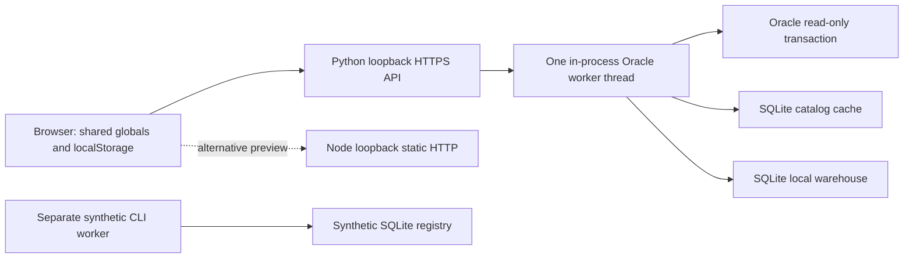

# U-ETL v2 Phase 0 — Executive summary

Audit date: 2026-10-26. Scope: the supplied local repository, assessed as a single-owner local pilot and against the proposed shared U-ETL v2. This is source-based discovery, not production certification.

## Method and evidence limits

Only the ten Markdown files in this directory are authorized outputs. No application code, configuration, dependencies, databases or infrastructure were changed in this audit. No tests, builds, migrations, application services, ETL jobs, database connections, arbitrary SQL, network probes or package installations were run. Earlier conversational test results are not fresh Phase 0 verification. Existing generated files and caches are not evidence of a working deployment.

Runtime, database grants, real Oracle connectivity, SPICE service behavior, browser behavior, target recovery and Local LLM availability: **NOT VERIFIED**. Database schemas below are inferred from DDL in source; no database contents were opened. Secret-bearing configuration values and production records are excluded.

Status vocabulary used throughout:

- **Implemented**: executable source exists for the stated narrow capability; runtime is still NOT VERIFIED.
- **Partial**: some genuine behavior exists, but persistence, governance, integration or scope is incomplete.
- **Mock**: synthetic data, timers, client-side authority or simulation supplies the claimed product behavior.
- **Planned**: requirements/types only; **NOT IMPLEMENTED** in the application.
- **Unknown**: cannot be established from this repository or requires external access.

## Current system

U-ETL is a vanilla JavaScript application with two alternative local hosting modes: a Node static HTTP preview and a Python HTTPS application serving the same assets plus Oracle APIs. The Python process owns HTTP threads, one Oracle worker thread, session credentials, job state, a SQLite metadata cache and a local SQLite warehouse. It is not currently a hybrid data platform.

Evidence: `index.html`; `package.json`; `serve.js`; `backend/spike/server.py:handler_for/main`; `backend/spike/service.py:Service.__init__/submit/_run`.

The synthetic CLI worker is disconnected from the live service. `backend/foundation/core.py:Registry/process_one` and `worker.py:main` provide lease/idempotency/checkpoint examples, but only for three built-in fixture records. They do not make Oracle jobs durable.

## Verified-by-source counts

- **15 implemented API method/route pairs**: 5 GET and 10 POST, including 6 Oracle action routes dispatched by `Service.submit`. Static assets, generic invalid `/api/*` paths, synthetic CLI calls and proposed documentation routes are excluded. See [API inventory](02-frontend-api-inventory.md).
- **24 explicitly defined feature units**: 9 Implemented, 8 Partial, 4 Mock, 3 Planned; 0 Unknown at that feature-unit level. Thus 17 have some real executable behavior, but only 9 meet the narrow Implemented definitions. This is not a count of production-ready features. External verification remains Unknown. See F01–F24 in [feature inventory](02-frontend-api-inventory.md).
- **SPICE integration: NOT IMPLEMENTED. SQL ETL: NOT IMPLEMENTED. Local LLM inference: NOT IMPLEMENTED.** `README.md`, `backend/contracts.ts`, `docs/api-contract.md`, actual imports and HTTP handlers support these conclusions.

## Major findings and highest risks

| Finding | Consequence | Evidence |
|---|---|---|
| Oracle work shares the Web/API process; jobs live in a session dictionary | API termination loses execution authority/status; no durable recovery | `service.py:Service.__init__/submit/_run/job` |
| Extraction accumulates all rows, then creates converted rows; row cap can be 2,147,483,647 | RAM exhaustion can take down the entire local application | `oracle_read.py:_query/extract_bounded`; `service.py:MAX_EXTRACT_ROWS` |
| Warehouse data and load registry use separate transactions | Data can commit while status/job reports failure | `target_store.py:load_rows/record_source_status`; `service.py:_run` |
| Decimal strings enter SQLite NUMERIC affinity | Precision loss and large numeric key collisions are possible | `oracle_read.py:extract_bounded.scalar`; `target_store.py:sqlite_type/load_rows` |
| Dataset approvals/definitions are browser objects; role selection is client-side | No enforceable shared approval, ownership or audit trail | `prototype.js:recordDatasetReview/approveDatasetDefinition`; `P.role` |
| Catalog refresh has persistent loading state without expiry/restart recovery | An abandoned refresh can block later refresh attempts | `catalog_store.py:begin_refresh`; `service.py:submit/_run` |
| HTML escaping is used inside JavaScript event attributes | Apostrophes can break handlers; crafted field text can reach script context | `sync-ui.js:safe`; `prototype.js:datasetCandidateReviewPanel`; `server.py:Handler.reply` |

See [prioritized risks](07-security-performance-risks.md) for 15 findings, contextual severity and mitigations. No P0 incident or externally exploitable production breach is established by this static audit.

## Recommended direction

Choose **option 2: retain and harden the current Web/UI control plane, separate ETL execution and AI inference**. Retain the screens, deterministic candidate baseline, Oracle metadata logic and behavioral tests. Redesign durable run/pipeline state, authentication, authorization, credentials, streaming and publication. Do not turn the synthetic registry into production simply by removing its guards.

Put a capability-based data-access boundary in front of SPICE and controlled direct connectors. Prefer SPICE only for capabilities verified against the actual service. U-ETL should own pipeline approval, run lifecycle, scheduling and target publication unless explicit service contracts assign ownership elsewhere. Do not assume SPICE provides CDC, bulk extraction, scheduling or an ETL engine.

The next phase is **architecture decisions and acceptance contracts**, not implementation: confirm SPICE identity/protocol/capabilities, deployment and user model, target atomicity, durable registry/queue, secret access, source budgets and Local LLM policy. Then define a bounded vertical-slice acceptance plan. See [recommendations](09-architecture-recommendations.md).

## Report index

1. [System inventory](01-system-inventory.md)
2. [Frontend and API inventory](02-frontend-api-inventory.md)
3. [Database and storage audit](03-database-storage-audit.md)
4. [SPICE readiness](04-spice-integration-readiness.md)
5. [ETL execution](05-etl-execution-audit.md)
6. [SQL ETL and AI mapping](06-sql-etl-ai-mapping-audit.md)
7. [Security and performance](07-security-performance-risks.md)
8. [v2 gaps](08-v2-gap-analysis.md)
9. [Architecture recommendations](09-architecture-recommendations.md)
