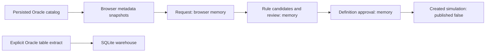

# Database and storage audit

Audit date: 2026-10-26. **Source DDL only; databases and production records were not opened.** Runtime file existence, data volume, disk encryption, backups and actual privileges are NOT VERIFIED. See [00](00-executive-summary.md).

## Storage topology

| Store | Purpose / location policy | Source and lifecycle |
|---|---|---|
| Oracle | External source selected by authorized local owner; no endpoint values reproduced | `service.py:oracle_factory`; `OracleReadAdapter.session` opens a fresh read-only transaction for each adapter operation and closes without commit |
| Catalog SQLite | `LOCALAPPDATA/UTAC/U-ETL Factory Data Bridge/oracle-catalog.sqlite3`, or home-based fallback | `server.py:main`; `CatalogStore.__init__` creates directory/schema, enables FK and WAL; tests/default Service may use :memory: |
| Warehouse SQLite | Same local directory, `local-warehouse.sqlite3` | `server.py:main`; `SQLiteTargetStore` opens per-operation connections and uses RLock in process |
| Synthetic registry SQLite | Explicit disposable path supplied to worker/tests | `Registry.__init__` guards environment/schema version; not part of live HTTP service |
| Browser localStorage | Origin-specific non-secret profiles, real metadata snapshots, load groups and synthetic demo state | `prototype.js:persist/persistRealSourceSnapshots/persistCollectionLoadGroups` |
| Process/browser memory | Sessions, credential copies, jobs, samples, dataset requests/reviews/definitions, simulated datasets | `Service.login/submit`; `realSourceUI`; `activeDataset*`; `window.datasetWorkflow*` |
| Temporary TLS files | Encrypted ephemeral key/certificate outside static root | `server.py:tls_context`; not a secret-store implementation |

HTTP and HTTPS ports are different browser origins and therefore do not share localStorage. No storage sync/migration between origins is implemented. SQLite cache persistence does not make browser profiles or dataset decisions shared multi-user records.

## Catalog schema

Source: `backend/spike/catalog_store.py:CatalogStore.__init__`.

| Table | Key and important fields | Behavior / limits |
|---|---|---|
| catalog_snapshots | id PK; source_key, state, started_at, completed_at, object_count | Loading/complete/failed states; persistent refresh state, not ETL job history |
| catalog_heads | source_key PK; snapshot_id FK | Points at latest complete snapshot; previous head retained during incomplete refresh |
| catalog_objects | PK(snapshot_id,schema_name,object_name,object_type); last_ddl_time | Pages appended to snapshot; FK cascade defined, but no retention/deletion routine found |
| object_metadata | PK(source_key,schema_name,object_name,object_type); last_ddl_time, JSON payload, updated_at | Columns/constraints only; source payload has no row samples; refreshed DDL/drop can invalidate metadata |

`Service._source_key` hashes endpoint identifiers and Oracle principal/runtime identity without passwords. It partitions metadata by source identity; it is not a user/tenant authorization mechanism. `complete_refresh` atomically switches catalog head and removes changed/dropped object metadata using LAST_DDL_TIME. Cross-page Oracle catalog reads are not one consistent source snapshot.

`begin_refresh` blocks if a loading snapshot exists. There is no owner lease, timeout, startup reconciliation or HTTP abandon endpoint. Browser termination between pages, session expiry or process crash can leave persistent loading rows that block later refreshes. `fail_refresh` is only called for failures handled by `_run` for the current catalog action. Existing catalog tests cover incomplete-head preservation, not automatic abandoned-refresh recovery.

## Warehouse schema and write semantics

Source: `target_store.py:load_rows/record_source_status/preview`; caller `service.py:_run`.

- Dynamic data tables are named `T_` plus the first 40 hex characters of SHA-256(source_key|schema|table), avoiding direct source names in physical target identifiers.
- Columns are selected source fields plus discovered PK fields; a composite `PRIMARY KEY` is declared. Identifier syntax is validated and values are bound with placeholders.
- NUMBER/FLOAT → NUMERIC; DATE/TIMESTAMP → TEXT; fallback → TEXT. The store supports BLOB mapping, but live service only admits a scalar-type allowlist; do not infer live LOB support.
- `_utl_table_registry`: PK(source_id,schema_name,object_name), target_table UNIQUE, last_load_at, last_received, target_rows. It stores the most recent load summary, not an append-only run history.
- `INSERT ... ON CONFLICT(pk) DO UPDATE` rewrites all selected non-key columns; keys-only tables use DO NOTHING. `rows_written` is SQLite total_changes delta, not separate inserted/updated/unchanged counts.
- Existing tables use `CREATE TABLE IF NOT EXISTS`; there is no column/type/key comparison, schema migration or ALTER path. Changed selected columns/types can fail or leave an older target layout.
- No durable staging tables, rejected-row store, publication generation, snapshot marker or committed watermark exists in this live target.
- Data transaction commits before `record_source_status` opens its separate transaction. No atomic data-and-status publication protocol exists.

Decimal is converted to string in `extract_bounded`, but inserting it into NUMERIC can coerce to INTEGER/REAL. Exact decimal fidelity and large numeric identifiers are therefore not guaranteed. Repeated key upsert reduces duplicate risk for an equivalent row set; it does not guarantee recovery from unordered rereads or a new source snapshot.

## Entity persistence matrix

| Entity | Real application storage | Synthetic/design storage | Assessment / evidence |
|---|---|---|---|
| Connection profile | Non-secret selected fields in localStorage; runtime credential config in memory | `Registry.metadata` accepts only demo-invalid/synthetic metadata | Partial; `safeConnectionProfile/persist`; no shared profile registry |
| Credential/session | Memory, passphrase hash and session token; secure browser cookie | SecretStore protocol with unavailable implementation | No durable unattended secrets; `Service.login`; `secrets.py` |
| Catalog metadata | Persistent SQLite snapshot and object tables; browser metadata cache | Connector/DiscoveredObject design types | Implemented for pilot; stale/retention limits above |
| Dataset request | `activeDatasetRequest` in browser memory | `DatasetRequest` interface only | No database persistence or request API |
| Candidate evaluation | Browser review array | Design provider/evaluation routes | No durable evaluation record |
| Dataset definition | `activeDatasetDefinition` in browser memory | `DatasetDefinition` type | No immutable server registry |
| Mapping definition | Live draft memory; synthetic P.mappings persisted in demo localStorage | Synthetic bundles store only ID/revision, not executable mappings | No executable, durable live mapping bundle |
| Approval records | activeDatasetDecisions and approvalState prototype-session-only | Role/revision concepts in design | No authenticated approver or append-only approval events |
| ETL jobs | Real read/load jobs in session.jobs, capped at 20 | Synthetic jobs table durable in separate harness | Live queue/status are not durable |
| Execution history | At most current-session jobs; local last-load registry | Demo history localStorage; synthetic jobs/audit | No live durable per-attempt history |
| Incremental checkpoint | None for real source | Demo watermark/upper/lower; synthetic checkpoint 0..3 | Mock/synthetic only; not Oracle progress |
| Audit log | P.audit/client activity memory | Synthetic audit table | No live server audit log |
| Dataset storage | Raw bounded table copies in warehouse | DatasetWorkflowItems simulation; demo target array | No approved business Dataset materialization |
| Staging | Extraction lists in RAM | Demo snapshots in arrays; TargetWriter.stage interface | No durable staging/replay artifacts |
| Load groups | localStorage ordered table keys | None | Browser-driven orchestration, no persisted group run |
| User/role records | None | Trusted synthetic Principal fixtures | Production user model absent |
| Schedules | Session-only cadence preference | Future requirements | No schedule rows or dispatcher |

## Synthetic registry is separate

`backend/foundation/core.py:Registry.__init__` defines registry_info (environment), metadata (id/revision/JSON), bundles (id/revision), jobs and audit. Jobs contain request_id UNIQUE, signature, scope, pinned bundle revision, fixture_id, retry_of, state, checkpoint, lease token/deadline, attempts, result, actor and timestamps. A partial UNIQUE active_scope index prevents multiple queued/running/cancel_requested jobs per scope. `transaction` uses BEGIN IMMEDIATE; PRAGMA user_version=1 is checked and foreign/newer schemas are rejected.

This is useful test evidence for state-machine patterns, not a live registry migration baseline. It rejects real connection metadata and only processes manufacturing-small-v1. No HTTP handler constructs Registry or calls its worker. Its audit actors are trusted synthetic fixture values, not authenticated users. Evidence: `Registry.save_metadata/enqueue/claim`, `process_one`, `server.py:main`.

## Dataset lifecycle and persistence break

There is no approved-definition-to-warehouse link. Time windows and filterRequest in the Dataset request are descriptions; they are not consumed by the table extractor. `createDatasetSimulation` copies summary fields but does not store an executable pipeline or publish data.

For v2, durable request/definition/review versions must precede scheduling and materialization. Model execution attempts, source boundaries, staging manifests, target generations and audit separately from catalog cache snapshots. Preserve existing local files as pilot artifacts until explicit migration/retention decisions; no migration was performed.
