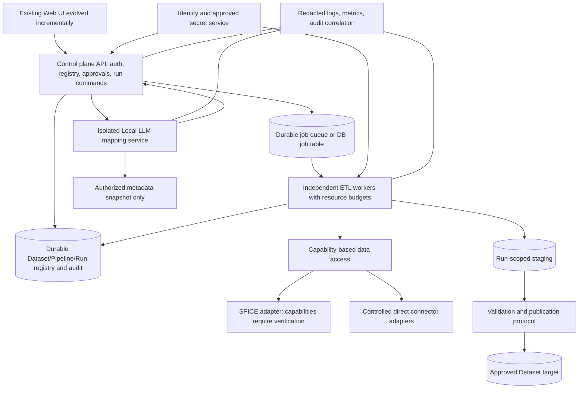

# Architecture recommendations

Audit date: 2026-10-26. **Proposed direction, not approved implementation.** Phase 0 ends with these reports. No new services, code, schemas, migrations, infrastructure or runtime experiments were created.

## Recommended approach and assumptions

Choose option 2: keep the existing Web/UI as the starting control plane, move data execution to an independent ETL worker, and put Local LLM inference behind its own service boundary. This directly addresses the current same-process `_run` and client-only Dataset state while retaining existing interaction flows. See [08](08-v2-gap-analysis.md) for all three approaches and tradeoffs.

Assumptions made for this recommendation: v2 will have shared users, jobs longer than an interactive request/session, and a need for recovery/approvals. Exact throughput, deployment OS, operations team, target engine and SPICE capability are Unknown. No database, queue broker, inference runtime or frontend framework is selected by this audit.

## Proposed boundaries

All nodes except the reusable current UI/Oracle concepts represent proposed responsibilities; this diagram is not current deployment. SPICE protocol, source/target locations and GPU availability remain Unknown.

| Boundary | Responsibilities | Explicit restrictions / current evidence |
|---|---|---|
| Web/UI | Author requests, visual/SQL plans, review candidates, inspect runs | No browser-authoritative role/approval; replace `activeDataset*` persistence incrementally |
| Control plane API | Authenticate/authorize, validate/version definitions, record review/approval, enqueue/cancel/retry commands, expose durable status | No bulk row conversion or inference; current `Handler/Service` is a pilot starting point |
| Dataset/Pipeline registry | Immutable source/definition/query/model refs, approvals, ownership, lineage and lifecycle | Distinct from `CatalogStore` cache and `_utl_table_registry` last-load summary |
| Durable job mechanism | Atomic submit, request identity, attempts, scope locks, leases/fencing, bounded dispatch | Database-backed queue first is viable if requirements allow; broker not preselected |
| ETL workers | Resolve approved source/target refs, establish boundaries, extract batches, transform/validate, stage and publish, record progress | Independent process uptime/resource controls; no interactive owner session dependence; no ad hoc model authority |
| Data-access adapters | Capability detection, identity-scoped catalog, preview/extract/cancel, limits and error translation | SPICE preferred only for verified capability; direct fallback explicitly authorized and audited |
| Local LLM service | Metadata-scoped retrieval and suggestions with structured evidence/versioning | No source credentials/sample rows by default; no direct SQL execution, target write or approval authority |
| Target publisher | Typed schema, run stage/quality, atomic publication/progress or documented recovery protocol | Do not generalize current local upsert into exactly-once/Dataset atomicity claims |
| Identity/secrets | User/service principals, object permissions, scoped unattended credentials and revocation | `UnavailableSecretStore` and synthetic Principal are not implementations |
| Operations | Correlated redacted audit/metrics, retention/backups, alerts, resource limits | Preserve error sanitization while adding operator diagnostics |

## Shared visual and SQL pipeline contract

Proposed common definition should carry pipeline/definition revision, authoring mode, source identity/config/catalog revisions, output schema and grain, typed transformations or approved SQL steps, dialect/parameter types, target generation, quality rules, extraction strategy and budget, approval evidence and provider/model/dictionary lineage where used.

Visual authoring and SQL authoring should resolve to the same immutable execution reference and pass the same authorization, preview, approval, enqueue, stage and publication gates. SQL need not be losslessly convertible to a visual graph. Persist opaque approved SQL where necessary. Model suggestions remain review inputs; generated SQL is never automatically privileged.

Current reuse evidence: `contracts.ts:DatasetDefinition/RunRequest/Connector/TargetWriter`, `applyDatasetReview/datasetDefinitionReadiness`, and `docs/incremental-backend-contract.md`. These are incomplete design/behavior assets, not a ready executable pipeline schema.

## Phased migration strategy — planning only

### Phase 1: close contracts and architecture decisions

Deliver a decision record covering service identity/deployment, target and registry ownership, SPICE capabilities, connector policy, SQL dialect/safety, Local LLM data policy and source resource budgets. Define acceptance criteria and an approved synthetic/sandbox verification plan. Do not expose the local API remotely to simulate a shared platform.

Exit gate: stakeholders agree what can be read, by whom, where work runs, where results live and what a committed run means. Every Unknown in [04](04-spice-integration-readiness.md) affecting the first slice has an owner and evidence requirement.

### Phase 2: durable control state and approval boundary

Plan durable Dataset/Pipeline/run/attempt/audit state, authoritative identity and revision-bound approval APIs. Retain UI flows and replace browser authority with server decisions. Reconcile actual snake_case API payloads and design camelCase types; distinguish read_completed from published/succeeded. Define secret references and operation-level permissions.

Exit gate for a later implementation: stale requests conflict; unauthorized review/run is denied server-side; approved versions cannot be silently mutated; no secrets enter queue payloads or client storage.

### Phase 3: independent bounded ETL vertical slice

Plan one certified source path and one approved target. Extract in bounded batches to run-scoped stage, validate types/PK/grain, publish under a tested atomic/recovery boundary, and expose durable progress. Prefer SPICE if it meets the verified extraction contract; otherwise use explicitly controlled Oracle capability without inventing SPICE guarantees.

Required future acceptance: process crash before/after enqueue, lease loss, worker crash during stage and before/after target commit, duplicate delivery, data/status consistency, exact numeric keys, schema drift, source timeout, byte/disk limit, cancel and restart. Restore prior approved generation after failed replacement. Existing test patterns in test_foundation/test_local_target/test_oracle_read are starting points, not passed evidence for this slice.

### Phase 4: SQL authoring and isolated mapping assistance

Plan dialect-safe authoring/preview, immutable SQL revisions and typed parameters through the same pipeline registry. Introduce a metadata-only Local LLM candidate provider with output schema/membership checks and model/prompt versions. Keep deterministic fallback and human approval. Execution of an approved pipeline should remain possible while inference is unavailable.

Exit gate: no invented IDs/joins silently pass; query preview is bounded and read-only; approval identifies exact query/plan and source snapshot; SQL/visual paths share execution/recovery behavior.

### Phase 5: certified incremental loading, scheduling and operations

Only enable incremental strategies after commit-order/snapshot/late-update/delete/initial-handoff evidence satisfies the existing incremental contract. Add authorized unattended secrets, timezone, missed-run/coalescing, overlapping-scope policy and durable schedule dispatch. Add recovery procedures, audit retention, monitoring/alerts and tested backups before expanding volume/engines.

Scheduling alone does not turn bounded unordered reads into incremental ETL. Do not promise CDC until a source/SPICE capability and supported recovery model have been verified.

## Open architecture decisions

| Decision | Evidence/owner needed | Default recommendation until decided |
|---|---|---|
| Exact SPICE service/version, protocols and supported operations | SPICE team and approved service contract | Mark all capabilities Unknown; no generic product assumptions |
| Local appliance vs shared server/platform | Product/operations/security | Preserve local pilot boundary until shared auth/hosting is designed |
| User identity and object-level authorization | Identity/security owner | Server-enforced principals; browser role is display state only |
| Registry and durable queue technology | Operations plus throughput/concurrency requirements | One logical durable authority; avoid premature microservices/broker choice |
| Target engine, transactions, stage and publication ownership | Data platform/DBA | Define exact fidelity/atomicity before implementation; SQLite remains pilot |
| Source admission and connection budgets | DBA/SPICE owners | Start bounded, explicitly scoped, low concurrency; no automatic access escalation |
| SPICE vs direct routing/fallback | Platform/security | Explicit capability policy and audit; never silently bypass SPICE permissions |
| Source consistency/incremental strategy | DBA and service owners | Initial bounded extraction only until a strategy is certified |
| Secret custody and unattended execution | Security/operations | Resolve scoped references in workers; no session-password queue transport |
| SQL dialect and transform location | Data platform | Read-only source extraction; transformations in approved stage/target engine |
| Local LLM runtime/model/GPU placement | AI/platform/security | Independent budget and metadata-only service; no model selection implied |
| Approval authority and backfill on mapping changes | Data owners | Immutable revisions, explicit review/backfill decision |
| Retention/classification/backups/recovery objectives | Data governance/operations | Record policies before retaining more raw data or scheduling |
| Workload/SLO/availability | Product/operations | Measure an authorized pilot before finer service decomposition |

## Phase 0 completion and stop boundary

Report checks confirmed ten requested Markdown files, resolved internal report links, balanced code fences, 15 API inventory rows and 24 feature rows (9 Implemented, 8 Partial, 4 Mock, 3 Planned). A before/after SHA-256 comparison of all 123 pre-existing files outside this report directory found no additions, removals or content changes. This is file-integrity/document validation, not application test execution or runtime certification.

This package supplies repository/feature/API/storage inventories, seven workflow traces, SPICE/SQL/LLM readiness, execution analysis, prioritized risks, gap matrix and three-option assessment. It does not certify runtime access or implement any future capability. Next action is review of decisions and an explicitly authorized next phase. **Stop here: do not begin implementation from this audit.**
