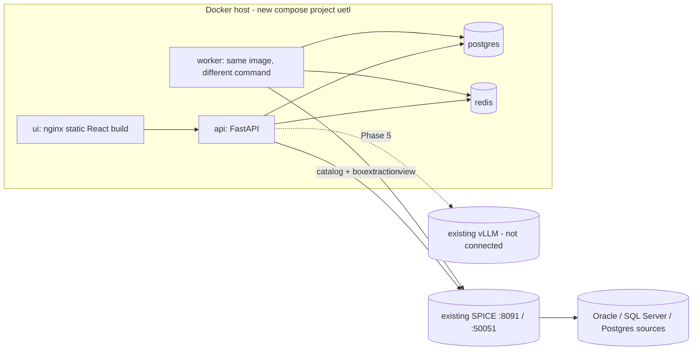

# 02 — Target architecture (proposal for Gate 0)

## Topology (Linux + Docker Compose)

Services: `ui`, `api`, `worker` (N replicas, resource-limited), `redis`, `postgres`. Compose files: `compose.yml` + `compose.dev.yml` / `compose.test.yml` / `compose.prod.yml` overrides. SPICE and vLLM are external hostnames in config; never provisioned.

## Trust boundaries
1. Browser ⇄ API: session cookie (HttpOnly, Secure, SameSite=Lax) + CSRF token on mutating routes. No secrets returned.
2. API ⇄ SPICE: only catalog + bounded preview (row/byte/time caps). Outbound URLs come from admin-registered connection records; hostnames validated against an allowlist/CIDR policy (SSRF).
3. Worker ⇄ SPICE: extraction; worker resolves secrets itself.
4. Redis: carries `{run_id, attempt}` only — no SQL, data or credentials.
5. PostgreSQL: three schemas, three roles — `registry` (API rw, worker rw on run tables), `staging` (worker only, run-scoped tables), `published` (worker write, API read-only). Migration role separate from runtime roles.

## Data flow of a run
API validates approved revision → inserts `job_run` (state `queued`, idempotency key) in PG → commits → enqueues to Redis (outbox row re-enqueues if the enqueue fails). Worker takes message → claims `job_attempt` in PG with lease token (fencing) → streams from SPICE in batches → writes batches to `staging.run_<id>_*` → validates quality rules → publishes → marks `succeeded` in the **same transaction** as the publish.

## Publish semantics (D9)
Each run writes `staging.run_<run_id>`. Publish transaction: verify lease token still current → `CREATE TABLE published.<t>__g<gen> AS/INSERT` from staging (or rename staging into `published` schema, same DB so rename is metadata-only) → repoint stable view `published.<t>` (`CREATE OR REPLACE VIEW`) to the new generation → update `dataset_generation`, watermark, `job_run.state='succeeded'` → COMMIT. Old generations are retained N versions, then dropped by retention job. Crash before COMMIT: nothing visible; staging reclaimed. Crash after COMMIT before ack: redelivery sees `succeeded` → no-op. Full-load only; incremental/CDC disabled.

## Queue & recovery protocol (at-least-once + idempotent)
- PG is authority: `job_run` (state machine queued→running→publishing→succeeded|failed|cancelled|dead), `job_attempt` (lease_token, lease_expires, heartbeat_at, checkpoint JSON).
- Idempotency key = (revision_id, trigger_id); unique index prevents duplicate runs; per-target advisory lock prevents concurrent publish to the same table.
- Worker heartbeat extends lease; reaper marks expired attempts and re-enqueues (attempt+1) with backoff; max attempts → dead-letter state + visible alert.
- Cancellation = flag in PG, checked between batches; best-effort only (SPICE cancel UNKNOWN).
- Budgets: row, byte, wall-time, staging-disk per revision; worker memory bounded by batch size (e.g. 10k rows) never whole-result.
- If SPICE cannot give bounded streaming (see 01 step 7), **Gate 3 is BLOCKED and options go to the owner**.

## Pipeline compilation
Visual graph and SQL both compile to a canonical **Execution Plan** (JSON, schema in 03). Round-trip: Visual → SQL always (generated, read-only view); SQL → Visual only when the AST maps cleanly to supported node types, otherwise one opaque `sql` node holds the verbatim text. Verbatim SQL is never rewritten; the checksum covers the text.

## SQL safety layers
(1) parse with dialect-aware parser, allow a single `SELECT` (CTEs ok); reject DDL/DML/multi-statement/functions on a denylist; (2) object allowlist resolved against the pinned catalog revision; (3) typed binds only; (4) SPICE-side read-only (+ source grants); (5) timeout/row/byte budgets; (6) transformation SQL runs only on the `staging` role which has no rights on `registry`/`published`.

## Failure modes (selected)
API down → runs continue (worker independent). Redis lost → outbox re-enqueues from PG; AOF limits loss. Worker killed → lease expiry → retry. PG down → API 503/readiness fails, workers pause. SPICE down → run fails with retry classification (no fallback to Oracle). Secret rotated mid-run → next attempt re-resolves.

## Observability / security
JSON logs with `X-Correlation-ID`, `/healthz` (liveness) and `/readyz` (PG, Redis, optional SPICE); audit_event append-only (no UPDATE/DELETE grant); argon2id password hashes; error responses sanitised; dependency pin + `pip-audit`/`npm audit` in CI.

## Framework decisions (to approve)
API FastAPI; ORM/migrations SQLAlchemy 2 + Alembic; Arrow client `pyarrow.flight`/`adbc-driver-flightsql` (only if verified); queue Dramatiq (D6); SQL parser sqlglot (D8); UI React + Vite + TS, React Flow (canvas), CodeMirror 6 (SQL), plain CSS variables (no heavy UI kit); tests pytest + Playwright. Versions to be pinned at Phase 1 from the then-current registry; not asserted here.
